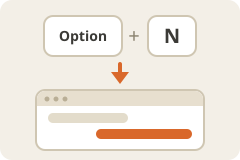

  

# Shortcut Guide

  

Didn't work? Create a Studio workspace and paste this to your agent:
` /use-template https://github.com/boweiliu/shortcut-guide-template`

## Why you care

A shortcut is hard to judge from a description. This is a short, clickable page that shows a Mac key press (Option+N) bringing Studio forward and raising the right chat, so a reader gets the idea in half a minute. It is also a ready pattern for explaining any prototype interaction as a three-step walkthrough.

## How to use it

Open **Shortcut Guide** from the workspace (it runs on port 8193 and is started by supervisord).

- The top of the page shows the key combination and what it does.
- The mock Studio window shows the result of the press; the numbered buttons **01**, **02** and **03** step through *before the press*, *Studio comes forward* and *chat is raised*.
- `GET /health` answers `{"status": "ok"}`.

To run it by hand from the workspace root: `uv sync --locked --project system/apps/shortcut_guide`, then `system/apps/shortcut_guide/.venv/bin/shortcut-guide`.

## Ideas for making it yours

- Replace the copy and the key combination with your own shortcut or gesture.
- Rename the example machine and tabs in the mock-up to match your own product.
- Add a fourth step to the walkthrough (for example, what happens when the chat is already in front).
- Add links at the bottom of the page to your own demo guide or team brief.
- Copy the app as a starting point for other one-page explainers: change the title and the page, keep the server.

## What this is

This repository is a published **Imbue Studio template**: a clean, bootable
snapshot of what an agent built, ready to adapt into your own. It is NOT the
generic workspace template -- it is this specific project.

[`template.md`](template.md) is the full manifest -- what it is, how it
works, what it needs to run, and what to adapt -- with the
machine-readable half (recipe, requirements, and the environment it needs
installed) in [`template.toml`](template.toml).
